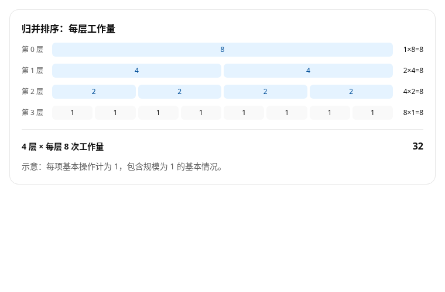

<div align="center">

# Inform UI Skill

**把答案变成可以阅读、操作和探索的页面。**

解释、图表、代码与本地交互，一份 HTML 交付。

[](LICENSE)
[](SKILL.md)
[](examples/agent-integration/)

[快速开始](#快速开始) · [选一个入口](#选一个入口) · [看示例](#从示例开始) · [Inform UI](https://github.com/Micraow/Inform-UI)

</div>

[](https://github.com/Micraow/Inform-UI)

<p align="center"><sub>Inform UI 库的公开 gallery，使用虚构数据。Skill 的可运行 DSL 示例见下方。</sub></p>

## 为什么用它

- **让结论更容易理解。** 文字、图表和表格共享数据，读者能看到“为什么”。
- **让读者试一试。** 调整阈值、筛选方案、选择条目，再一键重置。
- **把重复结构写成模板。** 一份数组和 `@Each` 就能生成一组卡片；嵌套数据用嵌套模板。
- **从小范围开始。** 基础组件够用就直接写，需要公式、引用等内容视图时再选精选版。
- **不必先搭工程。** Web Chat 读取一份 Skill 即可编写 HTML；Agent 也可用随包 CLI 校验。

## 快速开始

### Web Chat：交给模型一份 Skill

1. 下载仓库，把 [SKILL.md](SKILL.md) 提供给模型。
2. 描述你要解释的问题、数据和交互，要求输出完整 HTML。

> 用 Inform 做一份活动方案比较答案。允许调整预算、排序和选择；解释推荐理由，处理没有结果的情况。数据使用明确标注的原创示例，重复卡片用数据和 @Each 生成，输出完整 HTML。

**当前使用匹配的随包运行库。** 将 `assets/runtime/inform-ui.global.js` 和 `THIRD_PARTY_NOTICES.txt` 放到 HTML 旁，把唯一的外部 script 地址改成 `./inform-ui.global.js`，再用允许 JavaScript 的浏览器打开。[详细交付说明](references/delivery.md)

Skill 中的 latest 外链是发布模板；本快照尚未核实该外链与随包 JS 字节一致。已合入源码的新能力，不代表旧外链或缓存已经更新。

### Agent：按需发现，按同一合同校验

把完整仓库放入宿主支持的 Skill 目录，入口为根目录 `SKILL.md`。有终端时可用 Node.js 22+ 运行随包 CLI，无需安装依赖：

```sh
node scripts/inform-answer.mjs catalog
node scripts/inform-answer.mjs prompt --select base/layout,base/controls,base/charts --out prompt.txt
node scripts/inform-answer.mjs check examples/filter-sort-chart.openui --select base/layout,base/controls,base/charts
node scripts/inform-answer.mjs build examples/filter-sort-chart.openui --out output/answer.html --select base/layout,base/controls,base/charts
```

prompt、校验与渲染使用同一组模块。CLI 默认复制匹配的本地运行库。接入自己的模型服务，见 [JavaScript / TypeScript 集成示例](examples/agent-integration/)。

## 选一个入口

| 入口 | 什么时候用 |
| --- | --- |
| [基础版](SKILL.md) | 解释概念、展示代码、比较数据、做图表和本地交互 |
| [精选视图版](profiles/curated-web-chat/SKILL.md) | 在基础版之上，加入公式、指标、步骤、引文、引用和折叠说明 |
| [Agent 按需扩展](references/catalog.md) | 已明确需要某个额外模块或 View，再加载它的精确合同 |

每次选一个入口即可。下面的清单由实际 profile manifest 生成；全量目录中的名字不会自动成为当前 profile 的可用组件。

<!-- BEGIN GENERATED PROFILE COMPONENTS -->
<details>
<summary><strong>基础版：40 个 UI 构造器</strong> · 展开完整组件表</summary>

适合解释、数据探索、图表、代码和本地交互。 入口：[基础版](SKILL.md)。

| 模块 | 数量 | 包含组件 |
| --- | ---: | --- |
| 布局与容器 | 5 | `Stack`、`Row`、`Grid`、`Card`、`Box` |
| 文字与表格 | 6 | `Text`、`Heading`、`Badge`、`Divider`、`Alert`、`Table` |
| 本地控件 | 8 | `Button`、`Input`、`Textarea`、`Select`、`RadioGroup`、`Checkbox`、`Switch`、`Slider` |
| 图标 | 1 | `Icon` |
| 媒体 | 2 | `Image`、`Video` |
| 代码 | 2 | `Code`、`CodeView` |
| 图表 | 16 | `AreaChart`、`BarChart`、`HorizontalBarChart`、`LineChart`、`HeatmapChart`、`RadarChart`、`PieChart`、`RadialChart`、`FunnelChart`、`SegmentedBar`、`SingleStackedBar`、`ScatterChart`、`CalendarHeatmap`、`MiniAreaChart`、`MiniBarChart`、`MiniLineChart` |

另含 6 个数据构造器：`Series`、`Slice`、`Point`、`ScatterSeries`、`CalendarDay`、`CodeData`。它们用于组织输入，不计入 UI 构造器数量。

</details>

<details>
<summary><strong>精选视图版：49 个 UI 构造器</strong> · 展开完整组件表</summary>

完整包含基础版，再增加 9 个内容视图，适合公式、步骤、指标、引用和折叠说明。 入口：[精选视图版](profiles/curated-web-chat/SKILL.md)。

| 模块 | 数量 | 包含组件 |
| --- | ---: | --- |
| 布局与容器 | 5 | `Stack`、`Row`、`Grid`、`Card`、`Box` |
| 文字与表格 | 6 | `Text`、`Heading`、`Badge`、`Divider`、`Alert`、`Table` |
| 本地控件 | 8 | `Button`、`Input`、`Textarea`、`Select`、`RadioGroup`、`Checkbox`、`Switch`、`Slider` |
| 图标 | 1 | `Icon` |
| 媒体 | 2 | `Image`、`Video` |
| 代码 | 2 | `Code`、`CodeView` |
| 图表 | 16 | `AreaChart`、`BarChart`、`HorizontalBarChart`、`LineChart`、`HeatmapChart`、`RadarChart`、`PieChart`、`RadialChart`、`FunnelChart`、`SegmentedBar`、`SingleStackedBar`、`ScatterChart`、`CalendarHeatmap`、`MiniAreaChart`、`MiniBarChart`、`MiniLineChart` |
| 精选内容视图 | 9 | `MathView`、`BlockquoteView`、`SectionView`、`FigureView`、`DetailsView`、`CitationView`、`MetricView`、`StepsView`、`ChecklistView` |

另含 15 个数据构造器：`Series`、`Slice`、`Point`、`ScatterSeries`、`CalendarDay`、`CodeData`、`MathData`、`BlockquoteData`、`SectionData`、`FigureData`、`DetailsData`、`CitationData`、`MetricData`、`StepsData`、`ChecklistData`。它们用于组织输入，不计入 UI 构造器数量。

</details>

数量按可调用名称统计；`CodeView` 是 `Code` 的兼容别名，`SingleStackedBar` 是 `SegmentedBar` 的兼容名称。`Icon` 是一个组件，可按需检索 755 个官方图标；并非额外 755 个组件。
<!-- END GENERATED PROFILE COMPONENTS -->

## 从示例开始

| 示例 | 可以试什么 |
| --- | --- |
| [预算选择](examples/budget-choice.html) · [DSL](examples/budget-choice.openui) | 调预算、比较方案、保留选择，查看超出预算的提示 |
| [数据探索](examples/filter-sort-chart.html) · [DSL](examples/filter-sort-chart.openui) | 同一份筛选结果驱动文字、图表和表格 |
| [图文解释](examples/composed-explanation.html) · [DSL](examples/composed-explanation.openui) | 用指标、公式、步骤和图表解释平均数与中位数 |
| [分组模板](examples/repeated-groups.html) · [DSL](examples/repeated-groups.openui) | 两层 `@Each`、空组提示、选择和重置 |
| [Agent 集成](examples/agent-integration/) | 文本流、被动预览、最终校验、取消与过期回复 |

HTML 示例随完整仓库下载后可直接打开。数据均为示例；Agent 回放使用合成文本，不调用模型 API。

### 用基础组件组合结构图



这张图来自 Inform UI 实际渲染的原创教学示例。`Box` 提供有限的表面与尺寸 token，`Grid` 支持 1–8 列及明确的窄屏行为，`Text` 提供对齐、字号和字重选项。重复的层与格子由两层 `@Each` 生成，无需添加专用图解组件。

[查看图中示例源码](https://github.com/Micraow/Inform-UI/blob/dc3361d64fc2ff650c34633f35b484406a6817a3/examples/v2/layered-work.openui) · [学习重复结构](references/repeated-structures.md) · [截图来源](assets/screenshots/README.md)

## 文档与使用边界

- [组件目录](references/catalog.md) · [DSL 语法](references/dialect.md) · [HTML 交付](references/delivery.md)
- [维护与测试](references/maintenance.md) · [问题反馈](https://github.com/Micraow/Inform-UI-skill/issues)

这里处理给定数据和页面本地状态。外部查询、发送、订票或付款需要宿主另行接入。精简 profile 限定模型可用的组件合同，浏览器仍加载完整 bundle。图片、媒体、宿主权限、CSP 和剪贴板能力各有边界，详见交付说明。

Node 合同测试、浏览器验证和真实用户验收是不同层面的证据。组件数量与截图不代表所有场景都已验收，也不保证任意聊天预览器能执行 HTML。

## 参与改进

欢迎带上最小 DSL、使用的 profile 和运行库版本反馈问题。重复结构、边界数据和空结果都是很有价值的测试案例。开发检查与生成规则见 [维护指南](references/maintenance.md)。

[MIT](LICENSE) · [随包第三方声明](assets/runtime/THIRD_PARTY_NOTICES.txt)
